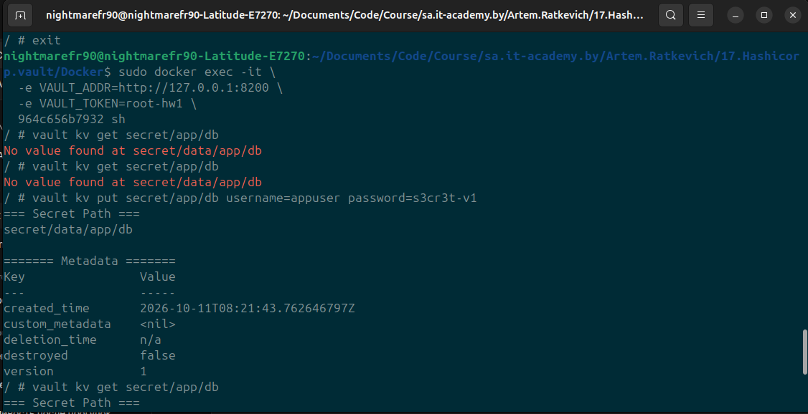
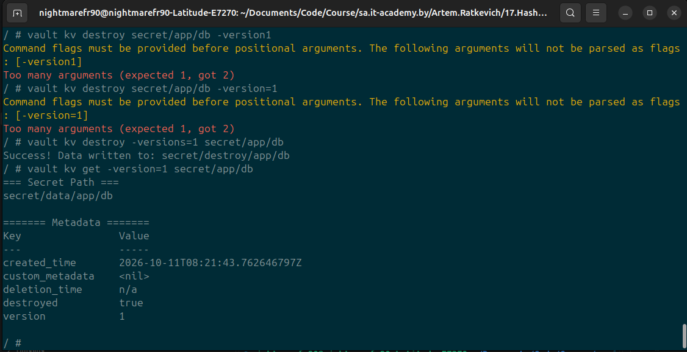
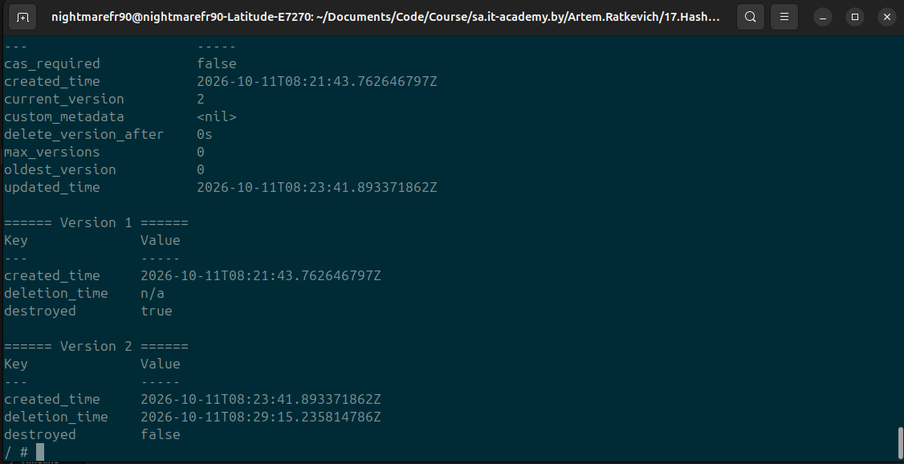
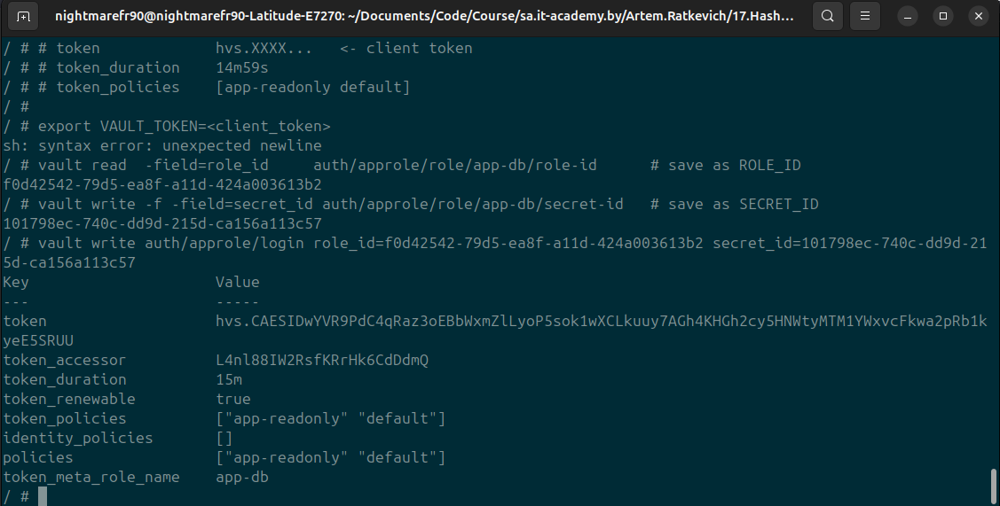
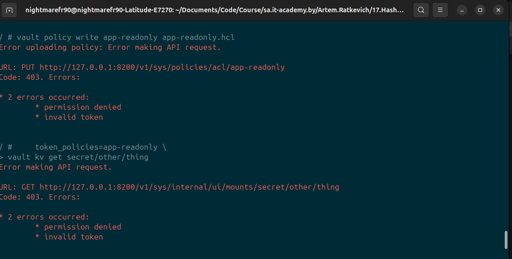
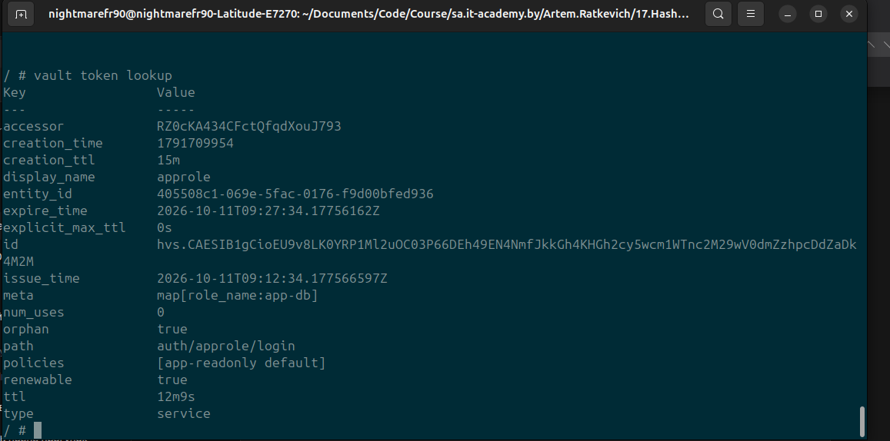
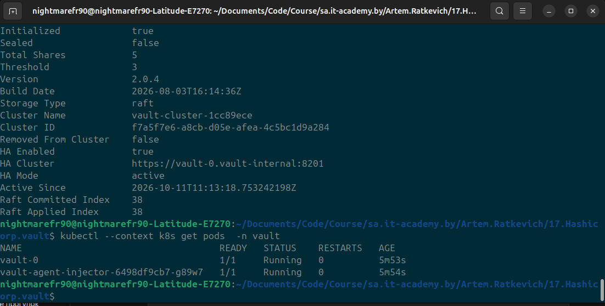
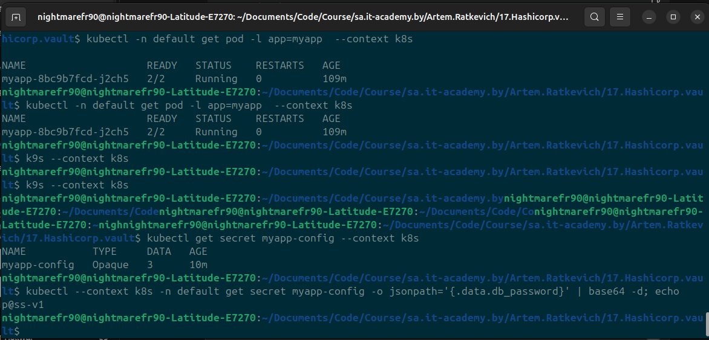
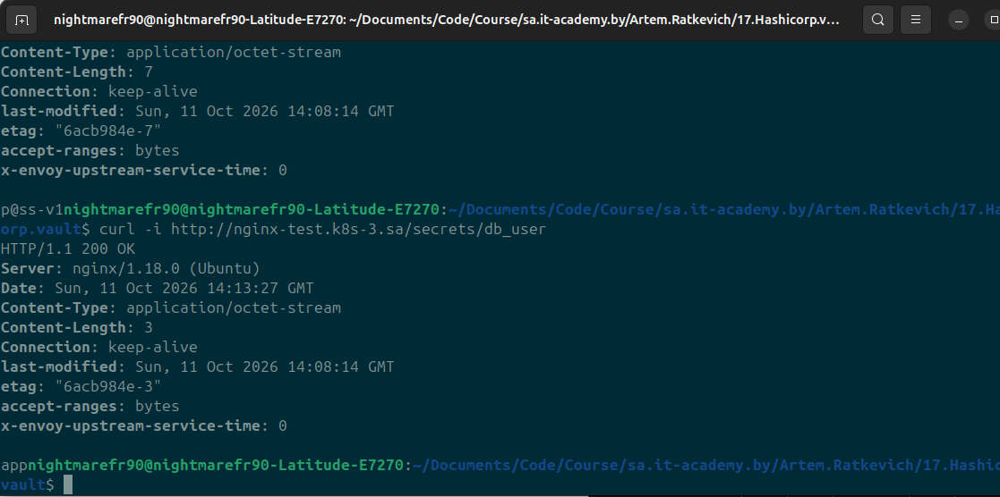

# 17. Hashicorp.Vault

## Assignment 1. Vault in Docker Compose

### Deploy Vault

```bash
docker compose up -d
docker ps # copy vault container id
docker exec -it -e VAULT_ADDR=http://127.0.0.1:8200   -e VAULT_TOKEN=root-hw1 964c656b7932 sh
```

### Storage (command inside container)
```bash
vault status

#Key             Value
#---             -----
#Seal Type       shamir
#Initialized     true
#Sealed          false
#Total Shares    1
#Threshold       1
#Version         1.20.4
#Build Date      2025-09-23T13:22:38Z
#Storage Type    inmem
#Cluster Name    vault-cluster-314ea657
#Cluster ID      95ec7db0-7987-b45f-b588-bb174b3ad74a
#HA Enabled      false
```

Description:

Sealed: false — the dev server unseals itself automatically on startup.
Shares/Threshold 1/1 — one single unseal key, no Shamir split (dev convenience only).
Storage Type: inmem — everything lives in RAM; a container restart wipes all secrets.
No TLS (plain http://), no audit devices — the whole config is "convenience over security".

### Work with secrets
```bash
# Add
vault kv put secret/app/db username=appuser password=s3cr3t-v1
vault kv get secret/app/db
vault kv get -field=password secret/app/db     # s3cr3t-v1

vault kv put secret/app/db username=appuser password=s3cr3t-v2   # same path => new version
vault kv get -version=1 secret/app/db          # old password, metadata shows version 1
vault kv metadata get secret/app/db            # current_version=2, per-version created_time

# Delete
vault kv delete secret/app/db
vault kv get secret/app/db            # Code: 404 "no value found"  — but:
vault kv metadata get secret/app/db   # version 2 still exists, deletion_time is set

vault kv undelete -versions=2 secret/app/db
vault kv get secret/app/db            # readable again, still version 2

vault kv destroy -versions=1 secret/app/db
vault kv get -version=1 secret/app/db # version still listed, but data is gone
vault kv metadata get secret/app/db   # version 1 now shows destroyed=true
```

### Policy
```bash
cat > app-readonly.hcl <<'EOF'
# Policies match API paths, not CLI paths:
#   CLI:  secret/app/db   ->   API: secret/data/app/db
path "secret/data/app/*" {
  capabilities = ["read"]
}
# optional, only needed for `vault kv list`:
path "secret/metadata/app/*" {
  capabilities = ["read", "list"]
}
EOF

vault policy write app-readonly app-readonly.hcl
vault policy read app-readonly

# Apply policy
vault auth enable approle

vault write auth/approle/role/app-db \
    token_policies=app-readonly \
    token_ttl=15m \
    token_max_ttl=30m

vault read  -field=role_id     auth/approle/role/app-db/role-id      # save as ROLE_ID
vault write -f -field=secret_id auth/approle/role/app-db/secret-id   # save as SECRET_ID

vault write auth/approle/login role_id=f0d42542-79d5-ea8f-a11d-424a003613b2 secret_id=101798ec-740c-dd9d-215d-ca156a113c57
# token             hvs.XXXX...   <- client token
# token_duration    14m59s
# token_policies    [app-readonly default]

export VAULT_TOKEN=64d72ec4-7faf-4c4b-a887-bbf9bcab301f
```

```bash
# 1) read allowed
vault kv get secret/app/db                 # returns username/password  ✔
vault token capabilities secret/app/db     # read

# 2) write denied
vault kv put secret/app/db username=x password=y
# Code: 403. Errors: * permission denied   ✔

# 3) other path denied
vault kv get secret/other/thing
# Code: 403. Errors: * permission denied   ✔
```








ttl counts down from token_ttl (15m). The token can be renewed up to token_max_ttl (30m).
When it expires: every API call returns 403 permission denied. The token is not resurrected — the client must re-authenticate via auth/approle/login with a fresh secret_id and get a new token. Long-running clients either renew in the background before expiry or simply re-login. Note the auto-attached default policy — that's what still allows token lookup/token renew on the AppRole token.

### Why dev mode must never be used in production

- Storage is inmem: a restart (or crash) destroys all secrets — no durability, no snapshots.
- It starts auto-unsealed with a 1/1 seal configuration — the security barrier is effectively decorative.
- The root token is a fixed value from an env var, printed in container logs, known to anyone with compose file access.
- Plain HTTP listener, no TLS, no mTLS between nodes, no audit logging.
- It disables hardening features (raw endpoint access, no replication/DR, no seal wraps). Dev mode optimizes for experimentation; production must use real storage (raft/consul), TLS, Shamir or auto-unseal via KMS, and audit devices.

### Why an application should authenticate with AppRole instead of the root token

- Least privilege. Our token can only read one path subtree. Root bypasses all ACLs — it can delete data, remove mounts, disable auth methods, revoke everything. A leaked AppRole credential is an inconvenience; a leaked root token is game over.
- Lifetime. The root token does not expire; AppRole tokens die in 15m (max 30m) and require re-authentication, limiting the window of abuse.
- Rotatable, constrained credentials. role_id is an identifier, not a secret; secret_id can be single-use, time-limited, CIDR-bound, and revoked individually.
- Audit & blast radius. Actions are attributable to role_name:app-db via token accessor, and a compromised app can be cut off without touching other consumers.
- Root tokens should be break-glass only: generated on demand, stored offline, and revoked after bootstrap.

## Assignment 2: Vault in Kubernetes and delivering a secret with VSO

### Clone helm packages and install
```bash
# helm.releases.hashicorp.com returns 403 from the academy network -> clone from GitHub:
git clone --depth 1 --branch v0.34.1 https://github.com/hashicorp/vault-helm.git
git clone --depth 1 https://github.com/hashicorp/vault-secrets-operator.git

kubectl create ns vault --context k8s
helm install vault ./vault-helm -n vault -f vault-values.yaml --kube-context k8s

kubectl create ns vault-secrets-operator --context k8s

helm install vault-secrets-operator ./vault-secrets-operator/chart -n vault-secrets-operator --kube-context k8s
```

### Init and unseal
```bash
kubectl --context k8s -n vault exec vault-0 -- vault operator init \
  -key-shares=5 -key-threshold=3 -format=json > vault-init.json
chmod 600 vault-init.json
echo vault-init.json >> .gitignore     # contains 5 unseal keys + root_token!
```

### Add kuber auth + roles (inside pod)
```bash
vault auth enable kubernetes

vault write auth/kubernetes/config \
    kubernetes_host="https://$KUBERNETES_SERVICE_HOST:443" \
    token_reviewer_jwt="$(cat /var/run/secrets/kubernetes.io/serviceaccount/token)" \
    kubernetes_ca_cert=@/var/run/secrets/kubernetes.io/serviceaccount/ca.crt

# Role bound to the operator's ServiceAccount & namespace:
vault write auth/kubernetes/role/vso \
    bound_service_account_names=vault-secrets-operator \
    bound_service_account_namespaces=vault-secrets-operator \
    policies=myapp-readonly \
    ttl=20m
```

### Install\Update deployment nginx
```bash
kubectl apply -f nginx.yaml --context k8s
```

### Check data from curl
```bash
curl -i http://nginx-test.k8s-3.sa/secrets/db_user
curl -i http://nginx-test.k8s-3.sa/secrets/db_password
```




