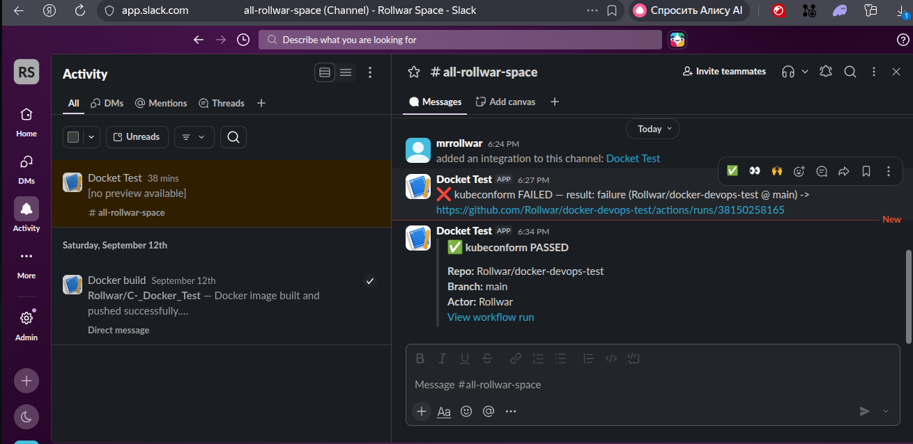

# Assignment 1\2

Original project: [DevopsTest](https://github.com/Rollwar/docker-devops-test)

## What was done
- Workflow .github/workflows/kubeconform.yml triggers on push and on PR to main.
- kubeconform runs in the official container ghcr.io/yannh/kubeconform:v0.6.7-alpine;git/curl/jq are installed inside the same container — nothing runs on the host runner.
- All folders containing *.yaml/*.yml are discovered and validated in parallel(job matrix, fail-fast: false, up to 5 parallel jobs).
- Aggregated Slack notification with status and run link (secret SLACK_WEBHOOK_URL).

## Results
[Action Result 1](https://github.com/Rollwar/docker-devops-test/actions/runs/38151818098)
[Action Result 2](https://github.com/Rollwar/docker-devops-test/actions/runs/38151818049)

