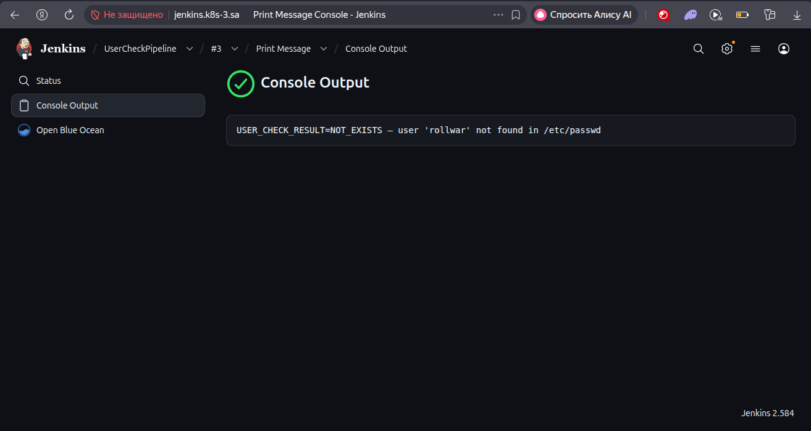
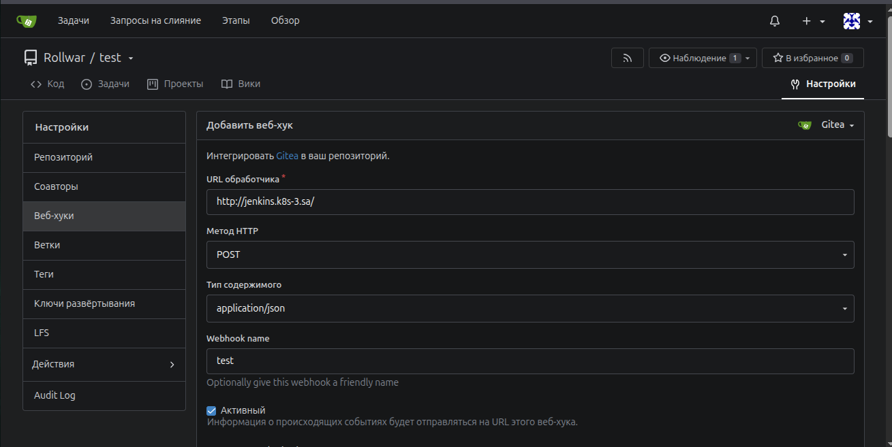
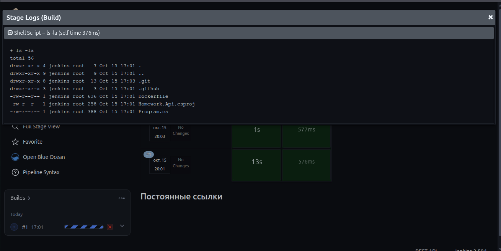

## Check user workflow
Run workflow (username) → POST /job/check-user/buildWithParameters
  → 201 + queue URL → poll queue → build URL → poll result → fetch consoleText → display

## Use Gitea webhooks
Need to install official Gitea Plugin.
Manage Jenkins → Plugins → install Gitea Plugin.
Manage Jenkins → System → Gitea Servers → Add: Name gitea, Server URL http://<gitea>:3000, credentials = a Gitea access token (Gitea → Settings → Applications → generate; add in Jenkins as username + token-as-password).
Job → Configure → Build Triggers → check "Build when a change is pushed to Gitea":
✅ Trigger on push
Filter by branch: ^(refs/heads/)?(main|master)$ (the refs/heads/ prefix makes it match in both webhook payload variants)
SCM branch specifier: */main.

### Screenshots 

