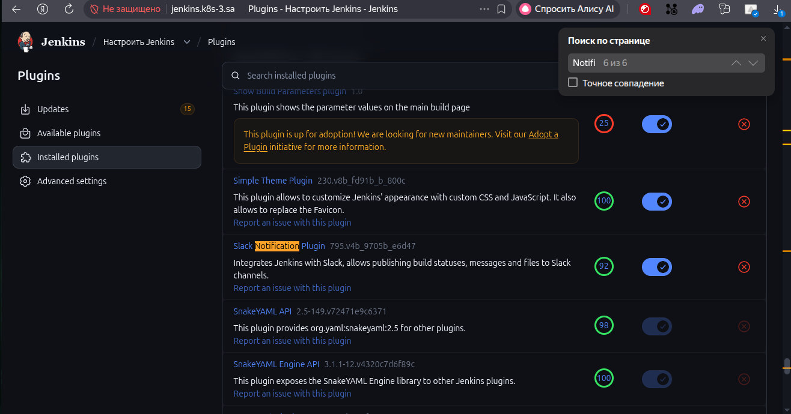
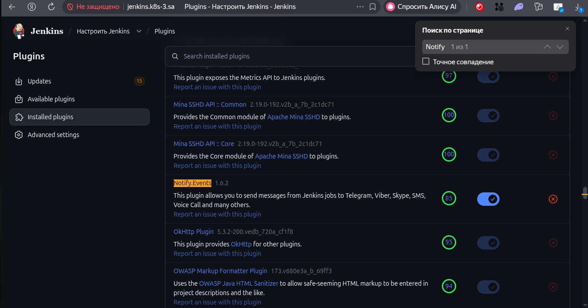
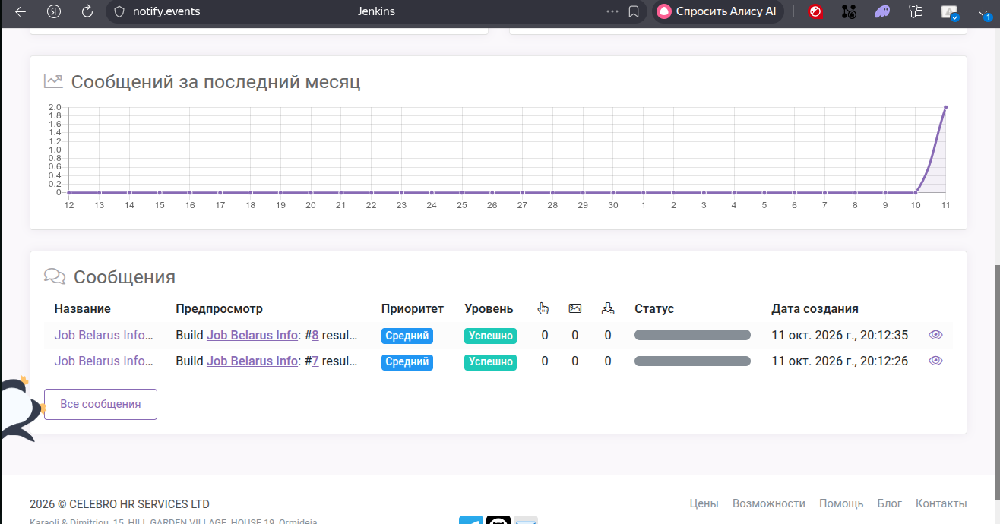

## Installation Jenkins
Use last installation guide from 15.Kubernetes.Application.deployment

### Read-only user
Manage Jenkins → Security → Authorization → select Role-Based Strategy → Save.
Manage Jenkins → Manage and Assign Roles → Manage Roles → add role viewer with exactly:
Permission
viewer
Overall → Read	✅
Job → Read	✅
View → Read	✅
everything else	❌

Manage Jenkins → Users → Create User → e.g. viewer / <password>.
Manage and Assign Roles → Assign Roles → assign user viewer to role viewer.
Result: this user can log in and see jobs/builds, but cannot configure jobs, create jobs, or touch Jenkins settings.

### Screenshots 

