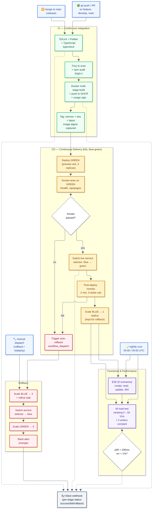
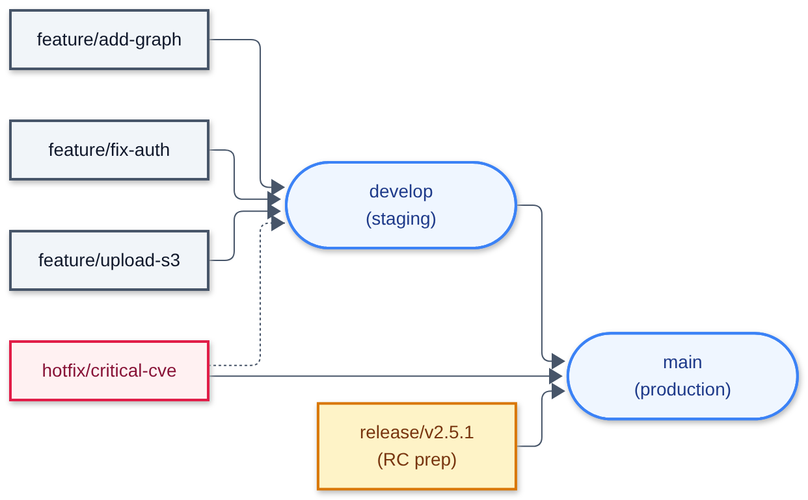

# Project Report

**Project Reporter:** Artem Ratkevich
**Group Number:** md-sa2-36-26

---

## 1. Application Description

| Field | Value |
|---|---|
| **Application name** | Wiki.js v2 (fork of [requarks/wiki-v2](https://github.com/Rollwar/wiki-v2)) |
| **Programming language(s)** | JavaScript (Node.js 20+), Vue.js (frontend), SCSS, Pug |
| **Database type** | PostgreSQL 15 (embedded StatefulSet in cluster; managed DB for production) |
| **Repository / site / package link** | App: [github.com/Rollwar/wiki](https://github.com/Rollwar/wiki) <br> Pipeline: [github.com/Rollwar/cicd-wikijs](https://github.com/Rollwar/cicd-wiki) <br> Image: `ghcr.io/rollwar/wiki:latest` |

## 2. Pipeline – High-Level Design



**Pipeline flow summary:**

```
Developer pushes to Rollwar/wiki (app repo)
        │
        ▼
┌─────────────────────────────────────────┐
│  CI Pipeline (ci-app.yml)               │
│  ┌────────────────────────────────────┐ │
│  │ lint-security (ubuntu-latest)     │ │
│  │   - yarn test (ESLint + Jest)     │ │
│  │   - yarn audit (non-blocking)     │ │
│  │   - Trivy fs scan (SARIF)         │ │
│  │   - artifact: ci-lint-security-   │ │
│  │     report                        │ │
│  └────────────┬───────────────────────┘ │
│               │                         │
│  ┌────────────▼───────────────────────┐ │
│  │ build (ubuntu-latest)              │ │
│  │   - Docker multi-stage build       │ │
│  │   - Push to GHCR                  │ │
│  │   - Cosign sign (keyless, main)   │ │
│  └────────────┬───────────────────────┘ │
│               │                         │
│  ┌────────────▼───────────────────────┐ │
│  │ trigger-cd (self-hosted)           │ │
│  │   - gh workflow run cd.yml        │ │
│  │   - cross-repo dispatch            │ │
│  └────────────────────────────────────┘ │
└─────────────────────────────────────────┘
        │
        ▼
┌─────────────────────────────────────────┐
│  CD Pipeline (cicd-wikijs/cd.yml)       │
│  self-hosted runner, kubectl context=k8s│
│                                         │
│  1. deploy-green                        │
│     - kubectl apply manifests           │
│     - Deploy GREEN slot (3 replicas)    │
│                                         │
│  2. smoke-test                          │
│     - In-cluster debug pod              │
│     - E2E tests against wiki-preview    │
│                                         │
│  3. switch-traffic                      │
│     - Patch Service selector → green    │
│     - Verify live URL (wiki.k8s-3.sa)   │
│     - Post-promote E2E                 │
│                                         │
│  4. scale-down-blue                     │
│     - Keep 1 replica for rollback       │
│                                         │
│  5. post-deploy-monitor                 │
│     - Poll live URL for 2 min           │
│     - Auto-rollback on 3 failures      │
└─────────────────────────────────────────┘
        │
        ▼
┌─────────────────────────────────────────┐
│  Kubernetes (k3s) cluster              │
│  Namespaces: wiki-staging, wiki-prod   │
│  Service mesh: Istio (Gateway + VS)    │
│  Blue-Green Deployment strategy        │
└─────────────────────────────────────────┘
        │
        ▼
   Slack notifications (success/fail/rollback)
```

### Branching strategy



| Branch | Triggers CI | Deploys to | Notes |
|---|---|---|---|
| `main` | ✅ Full CI | Production | `latest` tag + cosign signing |
| `develop` | ✅ Full CI | Staging | Integration branch |
| `release/*` | ✅ Full CI | Staging (tagged) | Release candidate preparation |
| `hotfix/*` | ✅ Full CI | Production | Fast-track critical fixes |
| `feature/*` (PR) | ✅ CI on PR | ❌ No deploy | Merge to develop after review |

---

## 3. Technologies Used

### Orchestration

| Tool | Role |
|---|---|
| **GitHub Actions** | CI/CD orchestration, workflow dispatch, matrix builds |
| **Self-hosted runner** | CD pipeline execution (has kubectl + context `k8s` + gh CLI configured) |
| **Kubernetes (k8s)** | Container orchestration, namespace isolation, blue-green deployments |
| **Cron (GitHub Actions schedule)** | Nightly E2E (04:00 UTC) and performance tests (05:00 UTC) |

### Automation tools

| Tool | Role |
|---|---|
| **Bash scripts** | Bootstrap, blue-green deploy, rollback, smoke tests, monitoring, notifications |
| **kubectl** | Cluster operations (apply, patch, scale, rollout, port-forward, exec) |
| **gh CLI** | Cross-repo workflow dispatch (`gh workflow run cd.yml`) |
| **jq** | JSON parsing for audit results, k6 metrics, Slack payload generation |
| **Docker Buildx** | Multi-stage builds with cache (`type=gha`), SBOM, provenance attestation |
| **k6** | Load testing with SLO thresholds (p95 < 200ms, error rate < 1%) |

### CI implementation

**Trigger types:**

| Trigger | Events | Target |
|---|---|---|
| **Hook (push)** | Push to `main`, `develop`, `release/*`, `hotfix/*` | Full CI pipeline |
| **Hook (PR)** | Pull request to `main`, `develop` | CI without push to GHCR |
| **Hook (tag)** | Semver tags `v*` | CI + production deploy |
| **Schedule** | Nightly cron `0 4 * * *` (E2E), `0 5 * * *` (performance) | Tests against deployed env |
| **Manual** | `workflow_dispatch` with inputs | Any stage on-demand |
| **Cross-repo** | `gh workflow run` from `wiki` → `cicd-wikijs/cd.yml` | CD trigger after build |

### Deployment flows

#### New deployment (initial bootstrap)

```bash
# 1. Apply namespace manifests
kubectl apply -f deploy/k8s/namespace.yaml

# 2. Bootstrap staging with initial image
bash scripts/bootstrap.sh wiki-staging ghcr.io/rollwar/wiki:latest

# 3. Bootstrap production
bash scripts/bootstrap.sh wiki-production ghcr.io/rollwar/wiki:latest
```

`bootstrap.sh` performs:
1. Creates namespace with `istio-injection=enabled` + `PodSecurity: baseline`
2. Applies ConfigMap (`DB_TYPE=postgres`, `DB_HOST=postgres`)
3. Applies Secret (`DB_PASS`, `PG_PASSWORD`, `SESSION_SECRET`)
4. Applies PVCs (postgres-pvc, wiki-uploads-pvc)
5. Applies postgres StatefulSet + Service (`sidecar.istio.io/inject: "false"`)
6. Applies live Service (`wiki`) + preview Service (`wiki-preview`) on port 80
7. Renders `deployment-slot.yaml` with `__SLOT__=blue`, `__IMAGE__=<image>` via `sed`
8. Applies wiki-blue Deployment, waits for `rollout status`
9. Applies Istio Gateway + VirtualService + DestinationRule (`wiki-stage.k8s-3.sa` / `wiki.k8s-3.sa`)

#### Upgrade deployment (blue-green, zero downtime)

```bash
# Triggered automatically by CI after successful build
# Or manually:
bash scripts/blue-green-deploy.sh ghcr.io/rollwar/wiki:v2.5.1 wiki-staging
```

**Blue-green logic:**

1. **Detect live slot** — reads `Service wiki` selector (`slot=blue` or `slot=green`)
2. **Deploy to opposite slot** — if live=blue, deploy new version to green; if live=green, deploy to blue
3. **Wait for rollout** — `kubectl rollout status deployment/wiki-<target>` (timeout 300s)
4. **Pre-promote E2E** — in-cluster debug pod tests `wiki-preview.<ns>.svc.cluster.local` (8 scenarios)
5. **Switch traffic** — `kubectl patch svc wiki` selector → new slot (atomic operation, <1s)
6. **Verify live URL** — `curl http://wiki-stage.k8s-3.sa/health/live` (10 retries)
7. **Post-promote E2E** — in-cluster debug pod tests `wiki.<ns>.svc.cluster.local`
8. **Scale down previous** — old live slot → 1 replica (kept warm for rollback)

**Zero downtime guarantee:**
- New pods pass `readinessProbe` (`/health/ready`) before Service routes to them
- Service selector switch is atomic in Kubernetes
- Old pods continue serving in-flight requests during graceful shutdown (`SIGTERM` handler in `server.js`)
- E2E tests confirm both pre-promote (new version) and post-promote (live traffic)

#### Rollback strategy

**Rollback process:**

1. **Detect current live slot** — reads Service selector
2. **Identify rollback target** — opposite slot (kept at 1 replica)
3. **Scale up rollback target** — `kubectl scale deploy/wiki-<target> --replicas=3`
4. **Wait for rollout** — `kubectl rollout status` (timeout 180s)
5. **Switch Service selector** — back to previous slot
6. **Verify URL** — `curl http://wiki.k8s-3.sa/health/live` (15 retries)
7. **Scale down failed slot** — `kubectl scale deploy/wiki-<failed> --replicas=0` (post-mortem, not deleted)

### Rollback commands

```bash
# Automatic (triggered by post-deploy-monitor)
# No action needed — workflow_dispatch to rollback.yml

# Manual rollback
bash scripts/rollback.sh wiki-staging
bash scripts/rollback.sh wiki-production

# Or via GitHub UI:
# Actions → Rollback → Run workflow → environment=production, reason="..."
```

---

## 4. References & Links

### Pipeline code repository

| Repository | Purpose | Link |
|---|---|---|
| **cicd-wiki** | Pipeline code (workflows, K8s manifests, Istio, scripts, tests, docs) | [github.com/Rollwar/cicd-wiki](https://github.com/Rollwar/cicd-wiki) |
| **wiki (app)** | Application code (fork of requarks/wiki-v2) + CI overlay | [github.com/Rollwar/wiki](https://github.com/Rollwar/wiki) |
| **GHCR package** | Docker image registry | `ghcr.io/rollwar/wiki:latest` |

### Additional resources

1. **Wiki.js v2 upstream** — [github.com/requarks/wiki-v2](https://github.com/requarks/wiki-v2)
2. App: [github.com/Rollwar/wiki](https://github.com/Rollwar/wiki) 
3. Pipeline: [github.com/Rollwar/cicd-wikijs](https://github.com/Rollwar/cicd-wiki)

### Cluster access

| Environment | URL | Namespace |
|---|---|---|
| Staging | `http://wiki-stage.k8s-3.sa` | `wiki-staging` |
| Production | `http://wiki.k8s-3.sa` | `wiki-production` |

