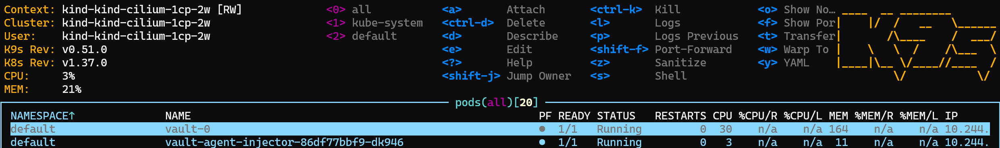
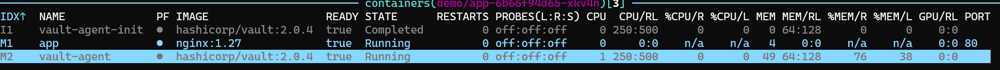
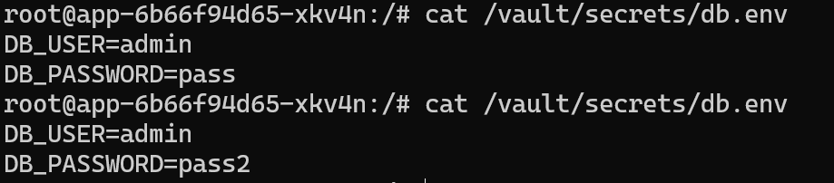

# 17.Hashicorp Vault
## Homework Assignment 1: Vault in Docker Compose - KV, policy, AppRole
### Storage
```bash
podman exec -ti vault-dev sh
/ # vault status
Key             Value
---             -----
Seal Type       shamir
Initialized     true
Sealed          false
Total Shares    1
Threshold       1
Version         1.17.6
Build Date      2024-09-24T19:48:40Z
Storage Type    inmem
Cluster Name    vault-cluster-27ae3e98
Cluster ID      54d8e5db-2df2-2440-9fd6-e3b5b7cab1aa
HA Enabled      false
-----------------------------------------------------
/ # export VAULT_TOKEN=root
/ # vault kv put secret/app/db username=admin password=pass
=== Secret Path ===
secret/data/app/db

======= Metadata =======
Key                Value
---                -----
created_time       2026-10-10T10:01:39.453641703Z
custom_metadata    <nil>
deletion_time      n/a
destroyed          false
version            1
/ # vault kv get secret/app/db
=== Secret Path ===
secret/data/app/db

======= Metadata =======
Key                Value
---                -----
created_time       2026-10-10T10:01:39.453641703Z
custom_metadata    <nil>
deletion_time      n/a
destroyed          false
version            1

====== Data ======
Key         Value
---         -----
password    pass
username    admin
/ # vault kv put secret/app/db username=admin password=pass2
/ # vault kv metadata get secret/app/db
==== Metadata Path ====
secret/metadata/app/db

========== Metadata ==========
Key                     Value
---                     -----
cas_required            false
created_time            2026-10-10T10:01:39.453641703Z
current_version         2
custom_metadata         <nil>
delete_version_after    0s
max_versions            0
oldest_version          0
updated_time            2026-10-10T10:03:34.55621512Z

====== Version 1 ======
Key              Value
---              -----
created_time     2026-10-10T10:01:39.453641703Z
deletion_time    n/a
destroyed        false

====== Version 2 ======
Key              Value
---              -----
created_time     2026-10-10T10:03:34.55621512Z
deletion_time    n/a
destroyed        false
```

* `kv delete` помечает версию секрета как удаленную, ее нельзя получить через `get`, но можно восстановить через `undelete`
* `kv undelete` снимает метку удаления и возвращает возможность `get` секрета
* `kv destroy` окончательно уничтожает данные указанных версий, помечая их метаданные как `destroyed=true`

### Policy

```bash
/ # vault kv get secret/app/db
=== Secret Path ===
secret/data/app/db

======= Metadata =======
Key                Value
---                -----
created_time       2026-10-10T10:03:34.55621512Z
custom_metadata    <nil>
deletion_time      n/a
destroyed          true
version            2

/ # vault kv put secret/app/db password=hacked
Error writing data to secret/data/app/db: Error making API request.

URL: PUT http://0.0.0.0:8200/v1/secret/data/app/db
Code: 403. Errors:

* 1 error occurred:
        * permission denied


/ # vault kv get secret/other/key
Error reading secret/data/other/key: Error making API request.

URL: GET http://0.0.0.0:8200/v1/secret/data/other/key
Code: 403. Errors:

* 1 error occurred:
        * permission denied


/ # export VAULT_TOKEN=root
/ # vault kv put secret/app/db password=hacked
=== Secret Path ===
secret/data/app/db

======= Metadata =======
Key                Value
---                -----
created_time       2026-10-10T10:15:53.446255356Z
custom_metadata    <nil>
deletion_time      n/a
destroyed          false
version            3
```

* why dev mode must never be used in production
> В dev mode весь трафик передается в незашифрованном виде, хранилище по умолчанию запускается сразу в распечатанном видет, хранилище записывается в ОЗУ и пропадает при перезапуске. Все эти допущения являются грубыми нарушениями безопасности и сводят весь смысл хранилища секретов в нулю
* why an application should authenticate with AppRole instead of the root token.
> Root-токен предоставляет абсолютный уровень прав. Роль приложения же позволяет дать строгие узкие права на конкретные серкреты и действия над ними, что соответствует принципу минимальных привилегий. К тому же роли можно определеить срок жизни или лимит использования

## Homework Assignment 2:  Vault in Kubernetes and delivering a secret with VSO


```bash
vault operator init
Unseal Key 1: MBF---
Unseal Key 2: zQj---
Unseal Key 3: 7db---
Unseal Key 4: tLt---
Unseal Key 5: vYt---

Initial Root Token: s.zJN---
vault operator unseal
vault operator unseal
vault operator unseal
/ $ vault status
Key             Value
---             -----
Seal Type       shamir
Initialized     true
Sealed          false
Total Shares    5
Threshold       3
Version         2.0.4
Build Date      2026-08-03T16:14:36Z
Storage Type    file
Cluster Name    vault-cluster-3855633a
Cluster ID      b2df0d78-f4ca-ef4e-f41b-6a78c1664dab
HA Enabled      false
vault login
vault secrets enable -path=secret kv-v2
vault kv put -mount=secret app username="admin" password="pass"
/ $ vault kv get -mount=secret app
== Secret Path ==
secret/data/myapp

======= Metadata =======
Key                Value
---                -----
created_time       2026-10-10T10:41:52.054520964Z
custom_metadata    <nil>
deletion_time      n/a
destroyed          false
version            1

====== Data ======
Key         Value
---         -----
password    pass
username    admin

vault policy write app-read - <<'EOF'
path "secret/data/app" {
  capabilities = ["read"]
}
EOF
vault token create -policy=app-read -ttl=1h

```

* What happens to the environment variables of a Pod that is already running after the rotation? Check printenv inside the Pod before and after. If the value did not change, explain why and what to do about it.

* How this compares to Sealed Secrets from lesson 13 — better in what way, worse in what way.
> Vault дает больше гибкости в работе с секретами: контроль выдачи, ротирование и время жизни; Самый главный выигрыш в том, что секрет сразу оказывается в поде, мниуя etcd и другие объекты К8с. В то же время для статических не меняющихся секретов он вносит бОльший объем работы при сомнительном выигрыше - запускаемое приложение должно уметь работать с ротируемыми секретами и в части случаев статиечсикх секретов, например, к БД, зашифрованных Sealed Secret, будет достаточно.
* What happens if you lose three of the five unseal keys but keep a full backup of the storage.
> При потере 3 из 5 частей ключа распечатывание БД больше невозможно и бэкап хранилища здесь не поможет - оно тоже запечатано. 