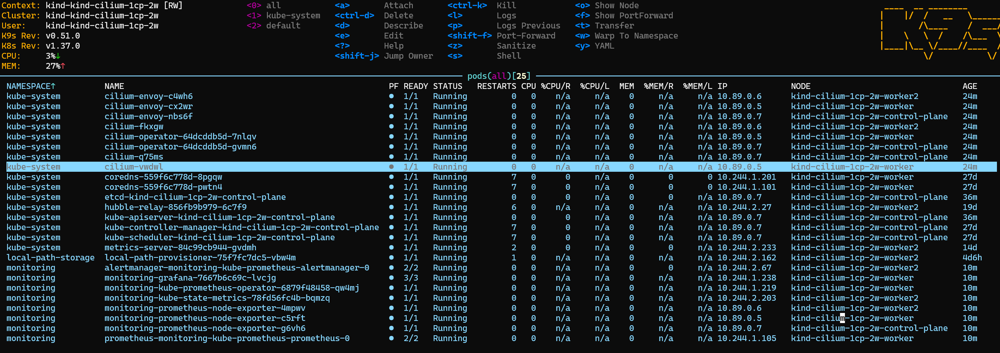
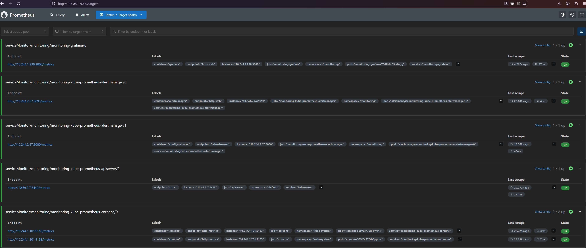
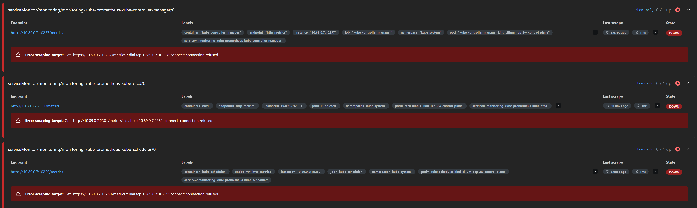
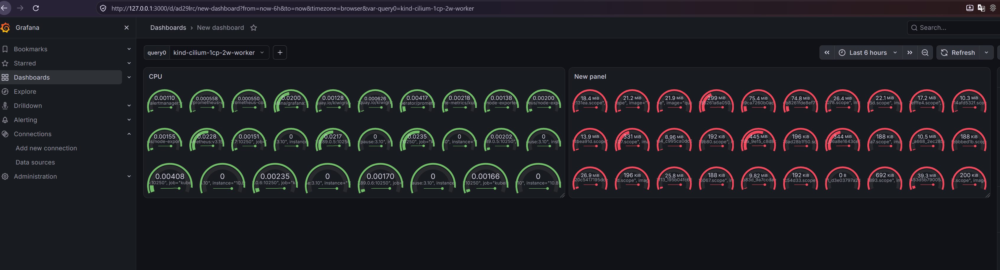
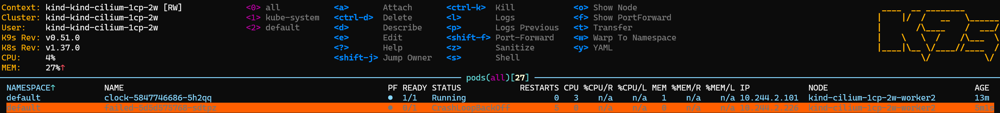
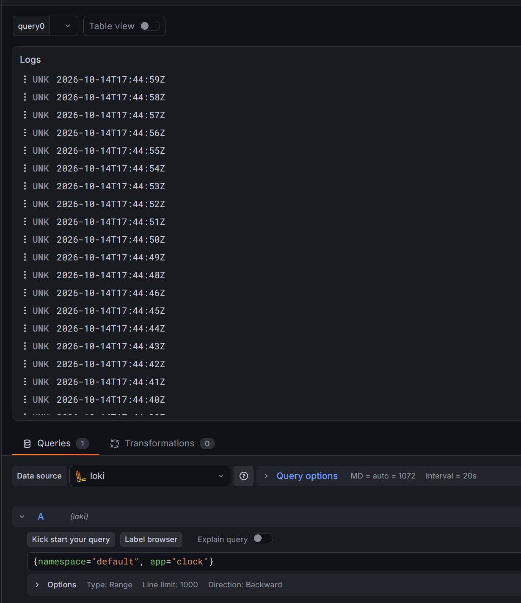
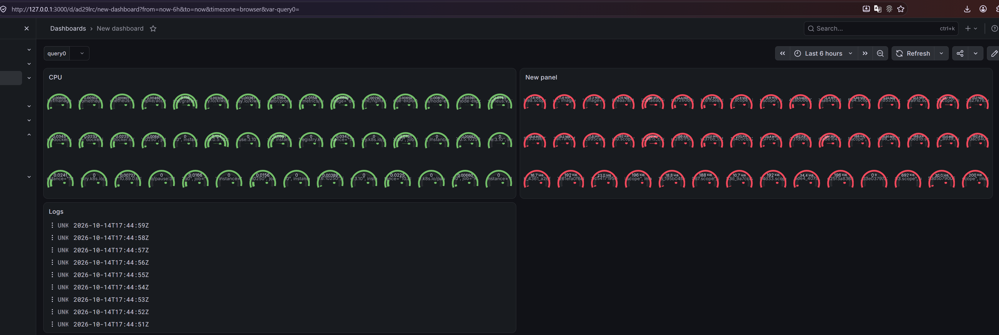

# 18. Technical and service monitoring
## Homework Assignment 1: Metrics stack and a dashboard





Некоторые конечные точки недоступны, так как их метрики отдаются только на localhost-интерфейсах и недоступны извне пода



## Homework Assignment 3: Logs - from kubectl to Loki

### Part A

Container Clock
```Dockerfile
FROM docker.io/library/alpine:3.22
USER 65534:65534
CMD ["sh", "-c", "while true; do date -u '+%Y-%m-%dT%H:%M:%SZ'; sleep 1; done"]
```

Container to exit code 1
```Dockerfile
FROM docker.io/library/alpine:3.22
USER 65534:65534
CMD ["sh", "-c", "echo Hello; exit 1"]
```



### Part B

Promtail values
```yaml
config:
  clients:
    - url: http://loki-gateway.monitoring.svc.cluster.local/loki/api/v1/push
```

Loki values
```yaml
deploymentMode: Monolithic
loki:
  auth_enabled: false
  commonConfig:
    replication_factor: 1
  storage:
    type: filesystem
  schemaConfig:
    configs:
      - from: "2024-04-01"
        store: tsdb
        object_store: filesystem
        schema: v13
        index:
          prefix: loki_index_
          period: 24h
singleBinary:
  replicas: 1
  persistence:
    enabled: true
    size: 5Gi
backend:
  replicas: 0
read:
  replicas: 0
write:
  replicas: 0
chunksCache:
  enabled: false
resultsCache:
  enabled: false
lokiCanary:
  enabled: false
test:
  enabled: false
sidecar:
  rules:
    enabled: false
```



